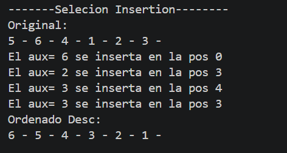

# PC 1.1.3 MD
ROGER MACAS
# METODO INSERTION

# EXPLICACION
Básicamente, el código toma el número actual en key y lo compara hacia atrás para buscarle su lugar. Mientras encuentre elementos más pequeños, el while los va rodando una posición a la derecha para abrir espacio; ahí mismo metes el sout para que imprima en pantalla qué número se está moviendo y en qué índice j ocurre esa jugada. Una vez que termina de mover todo, coloca el key en el huequito libre que quedó con arreglo[j + 1] = key.
# EJECUCION CODIGO

