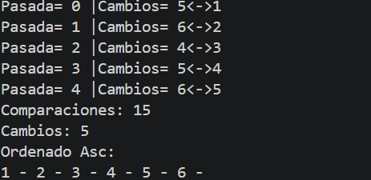

# PRACTICA SELECTION
Roger Macas

# CODIGO HECHO:

# IMPRESIONES SOLICITADAS:
Se vio donde se agragaban cambios y pasadas como dentro de los 2 bucles se ejecutan las pasadas
y tambien el cambio se le hizo sout dentro de el 2do bucle para que cada que se repitiera se hiciera la selecion solicitada pus

# CODIGO EJECUTADO:

